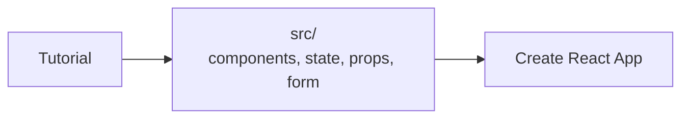

> **Fork of [taniarascia/react-tutorial](https://github.com/taniarascia/react-tutorial).** A walkthrough of basic React concepts (components, state, props, forms), kept for reference. The upstream README follows unchanged.

## Architecture

## Related repos

| Repo | Relationship |
|---|---|
| [taniarascia/react-tutorial](https://github.com/taniarascia/react-tutorial) | Upstream project |

---

# React Tutorial

Learn the fundamentals of React, including simple and class components, state, props, and submitting form data.

### [View the demo](https://taniarascia.github.io/react-tutorial/) | [Read the tutorial](https://www.taniarascia.com/getting-started-with-react/)

## Purpose

- Learn about essential React concepts and related terms, such as Babel, Webpack, JSX, components, props, state, and lifecycle.
- Build a very simple React app that demonstrates the above concepts.

## Author

- [Tania Rascia](https://www.taniarascia.com)

## License

This project is open source and available under the [MIT License](LICENSE).
